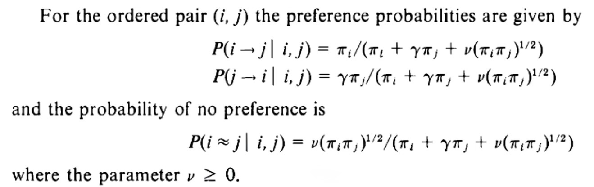

## The short version

The fundamental purpose of this site is to predict the result of a future game in the Premier League. (After all, if we can do this for one game, we can do it for a whole season of games.)

To predict a game, we look across the past results of all the teams in the league. We then find the ideal mix of three settings that best matches these past results. These settings are:

  - The strength of each side
  - The importance of home advantage across all teams
  - The likelihood of a draw in an even contest

As it happens, using just these three settings proves to be a reliable way to predict the results from games in a new season. The same cannot always be said for approaches with more bells and whistles.

 

## The detail

The idea to use these 'three settings' came from Davidson and Beaver [-@davidson1977]. In the notation of their paper below: 

  - *i*  is the home team and *j*  is the away team
  - The bit on the left side of the first equation means 'the probability of *i* beating *j*  ' (i.e. the chance of a home win)
  - The second equation deals with an away win
  - The final equation shows the chance of a draw

 

  
 

If we add the numerator of all three equations, we get the denominator of each equation. This means that the probability of a home win, away win and draw rightly sum to 100%.

Looking in a bit more detail, we see these 'three settings': 

  - $\pi_i$ and $\pi_j$ are the strengths (of the home and away sides, respectively)
  - $\gamma$ is the home advantage (which is between 0 and 1, dampening the usual strength of the away side)
  - $\nu$ is a parameter that deals with the likelihood of a draw in an even contest
  
This all seems complicated but the reality is simpler. 

In short, our approach reduces to collecting the past results for all the teams in the league, before finding the ideal mix of the three settings that best matches these previous results. To find this ideal mix of settings, we use the implementation from the *BradleyTerry2*  package [-@turner2010].

 

## A worked example

Let's make our predictions for a specific game. In this case, we'll choose a late-season game from a previous season, with Aston Villa at home to Tottenham Hotspur, and use the settings as they were then. (Of course, you could use the current settings, shown later on this page, should you wish.)

Going back to the snippet above, we now have:

  - $\pi_i$ -- the strength of Aston Villa (0.0615)
  - $\pi_j$ -- the strength of Tottenham Hotspur (0.0321)
  - $\gamma$ -- the home advantage shown across all grounds in the league (0.687)
  - $\nu$ -- a parameter that helps to determine the likelihood of a draw for an even contest (0.220)

 

Substituting these example settings into the three equations gives us our predictions for this game. Let's start with a home win.

$$
P(VillaWins)
=
\frac{\pi_i}
     {\pi_i + \gamma \pi_j + \nu (\pi_i \pi_j)^{1/2}}
$$

In other words,

$$
P(VillaWins)
=
\frac{0.0615}
     {0.0615 + 0.0687*0.0321 + 0.220*(0.0615*0.0321)^{1/2}}
$$

... which becomes,

$$
P(VillaWins)
=
\frac{0.0615}
     {0.0735}
= 0.8370
$$

 

And now for the away win,

$$
P(TottenhamWins)
=
\frac{\gamma \pi_j}
     {\pi_i + \gamma \pi_j + \nu (\pi_i \pi_j)^{1/2}}
$$

That is:

$$
P(TottenhamWins)
=
\frac{0.0687*0.0321}
     {0.0735}
=
\frac{0.0022}
     {0.0735}
= 0.0300
$$

 

Finally, let's consider the draw.

$$
P(Draw)
=
\frac{\nu (\pi_i \pi_j)^{1/2}}
     {\pi_i + \gamma \pi_j + \nu (\pi_i \pi_j)^{1/2}}
$$

That is,

$$
P(Draw)
=
\frac{0.220*(0.0615*0.0321)^{1/2}}
     {0.0735}
=
\frac{0.0098}
     {0.0735}
= 0.1330
$$

 

Bringing together these calculations, we get our predictions: an 83.7% chance of a home win for Aston Villa; a 3.0% chance of an away win for Tottenham Hotspur; and a 13.3% chance for a draw.

 

## Our assumptions

In order to predict anything, you need to make assumptions. Some of these assumptions are explicit, whilst others are implicit.

To consider this statement further, let's return to our example. 

Over the last two full seasons, Tottenham Hotspur has struggled, finishing in 17th position on each occasion. Our predictions reflect that reality in assigning the team its relatively-weak strength setting. 

However, our predictor doesn't know that a highly-regarded new manager has been recently been hired, spending lots of money on new players.

Given this potential weak point in our approach, we often find it useful to blend the results from a longer-term assessment (over two and a bit years) with corresponding results from a shorter-term assessment (perhaps over the last half-season). In doing so, we boost the importance of more recent results in our predictions.

Furthermore, given that the model only considers results, it cannot directly reflect specific events, such as tragedies or points deductions (although 'what-if' analysis could be conducted for given levels of points deduction for a specific team).

Whilst this is not an exhaustive list of assumptions, the final one to note is that the team strengths are fixed across the year when they are set and are not assumed to evolve week-by-week based upon future performances.

Overall, this suggests that our model is useful in simplifying the real world in order to give a framework to understand the mechanisms at play in the Premier League competition. It is not, however, a way to predict with perfect foresight the outcome of any game or season. As such, if a number says 0% or 100%, treat it with a pinch of salt.

 

## Show me the numbers

OK, so that's the theory, but what does it mean in reality? We'll now discuss the latest values for these three settings, which we update after every round of games.

In this instance, we'll deliberately use results from this season so far and its two complete predecessors. 

When we collect all this data and seek the best-fit mix of settings, we currently find the following coefficients.

<iframe
  src="https://p0bs.github.io/pp2-scan/table_coefficients.html"
  title="table_coefficients"
  class="weeklyCoeff"
  loading="lazy"
  referrerpolicy="no-referrer">
</iframe>

You now have all the information that you need to make your own predictions!

 

## License and disclaimer

The license for any materials on this website is set to be identical to its [associated GitHub repo](https://github.com/p0bs/pp2-scan). 

You can [read this license here](https://github.com/p0bs/pp2-scan?tab=MIT-2-ov-file). It includes (but is not limited to):

> THE SOFTWARE IS PROVIDED "AS IS", WITHOUT WARRANTY OF ANY KIND, EXPRESS OR IMPLIED, INCLUDING BUT NOT LIMITED TO THE WARRANTIES OF MERCHANTABILITY, FITNESS FOR A PARTICULAR PURPOSE AND NONINFRINGEMENT. IN NO EVENT SHALL THE AUTHORS OR COPYRIGHT HOLDERS BE LIABLE FOR ANY CLAIM, DAMAGES OR OTHER LIABILITY, WHETHER IN AN ACTION OF CONTRACT, TORT OR OTHERWISE, ARISING FROM, OUT OF OR IN CONNECTION WITH THE SOFTWARE OR THE USE OR OTHER DEALINGS IN THE SOFTWARE.
